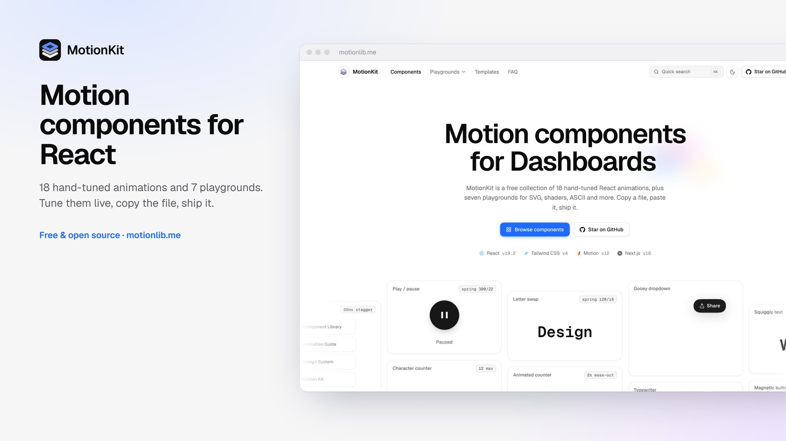
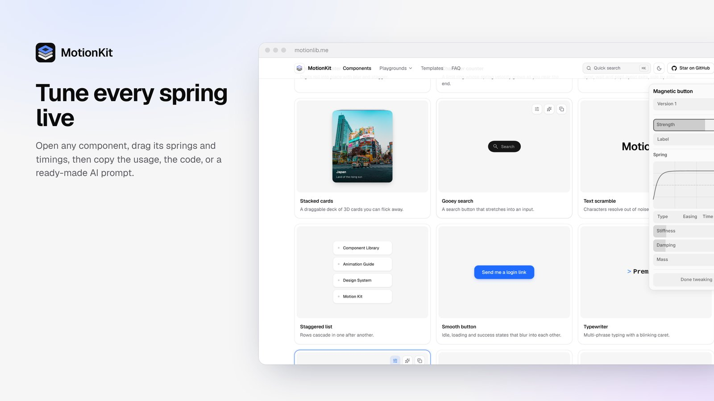
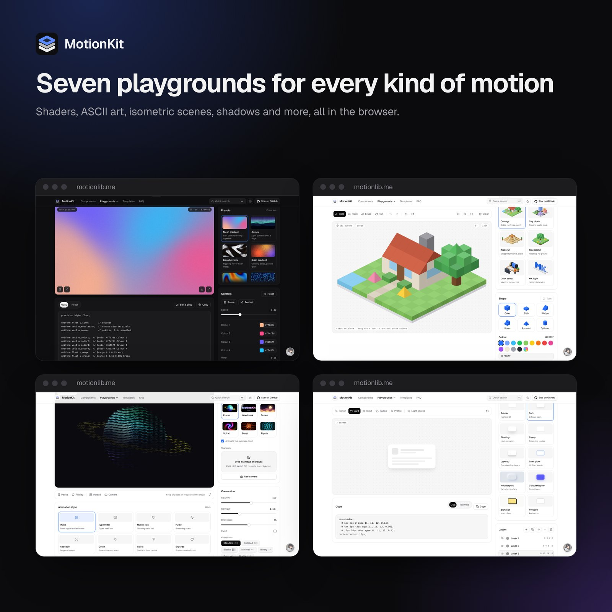

# MotionKit

**Motion components for React. Tune them live, copy the file, ship it.**

[motionlib.me](https://www.motionlib.me/)



https://github.com/user-attachments/assets/3b8f7188-6380-4c8c-9b89-3109fd123367

MotionKit is a free collection of 18 hand-tuned React animations and 7 browser playgrounds. It isn't a package you install: each component is a single file you copy into your project and own.

[](https://nextjs.org/)
[](https://react.dev/)
[](https://motion.dev/)
[](https://tailwindcss.com/)

## Tune every spring live



Every component card has three actions:

- **Tweak:** opens a live panel (built on [DialKit](https://github.com/joshpuckett/dialkit)) with the component's real props: springs, timings, text and sizes. The preview updates as you drag, and a ready-to-paste usage line shows your tuned values.
- **Copy AI prompt:** copies a prompt for your AI assistant with the install command, file path, usage with your tuned values, and the full source.
- **Copy code:** copies the component file exactly as it is in this repo.

## Components

| Component | What it does |
| --- | --- |
| SVG gradient trace | A radial gradient stroke that follows the cursor across SVG paths |
| Play / pause morph | Icon paths morph between states on a spring |
| Gooey dropdown | A menu that melts out of its trigger with an SVG goo filter |
| Animated counter | Digits roll into place with blur and stagger |
| Character counter | A limit counter whose spring velocity grows as you near the end |
| Presence modes | `sync`, `wait` and `popLayout` exits, side by side |
| Stacked cards | A draggable deck of 3D cards you can flick away |
| Gooey search | A search button that stretches into an input |
| Text scramble | Characters resolve out of noise with a soft blur |
| Staggered list | Rows cascade in one after another |
| Smooth button | Idle, loading and success states that blur into each other |
| Typewriter | Multi-phrase typing with a blinking caret |
| Magnetic button | A button that leans toward your cursor |
| Letter swap | Shared letters glide between words |
| Parallax tilt card | 3D perspective and glare that track the pointer |
| Scroll reveal | Fade and rise as content enters the viewport |
| Squiggly text | A hand-drawn wobble from an SVG turbulence filter |
| Bunny mascot | An SVG character whose eyes follow you around |

Every component exposes its springs and timings as props, with defaults that match the demo. They support light and dark mode, and the ones with continuous motion respect `prefers-reduced-motion`.

## Playgrounds



| Playground | What you can do |
| --- | --- |
| [Shaders](https://www.motionlib.me/shaders) | Tune 12 GPU shader backgrounds or write your own GLSL, then export a React component or PNG |
| [ASCII animator](https://www.motionlib.me/ascii) | Turn built-in examples, images or your camera into animated text art; export text, PNG or video |
| [Isometric maker](https://www.motionlib.me/isometric) | Build block scenes from six examples, with undo/redo; export SVG, PNG or JSON |
| [Shadow studio](https://www.motionlib.me/shadow) | Layer realistic shadows with a light source and copy CSS or Tailwind |
| [SVG studio](https://www.motionlib.me/svg) | Draw shapes, vectorize images or make ASCII patterns; copy JSX or SVG |
| [Backgrounds](https://www.motionlib.me/background) | Gradient, mesh and grid presets with grain; copy CSS or Tailwind |
| [CSS playground](https://www.motionlib.me/css) | Shape, transform and filter an element and preview its transition |

Press <kbd>⌘K</kbd> anywhere on the site to jump to any component or playground.

## Use a component

1. Install Motion if your project doesn't have it. Most components import from `framer-motion`, a few from `motion/react`:

   ```bash
   npm install framer-motion motion
   ```

2. On [motionlib.me](https://www.motionlib.me/), open a component, tune it if you like, and press **Copy code** (or **Copy AI prompt** to let your assistant set it up).
3. Paste it into a file such as `components/motion/magnetic-button.tsx` and render it:

   ```tsx
   import MagneticButton from "@/components/motion/magnetic-button";

   <MagneticButton strength={0.4} />
   ```

Components are styled with Tailwind CSS classes. Without Tailwind, convert the classes to your own CSS.

## Run the site locally

```bash
git clone https://github.com/NamanSharma2112/MotionKit.git
cd MotionKit
npm install
npm run dev
```

Then open http://localhost:3000.

### Project layout

```
app/
├── page.tsx                  # Homepage: hero, live component grid, spotlight, FAQ
├── layout.tsx                # Site header, footer, metadata, contact card
├── ui.css                    # Design tokens and shared site styles
├── <playground>/page.tsx     # shaders, ascii, isometric, shadow, svg, background, css
└── compoents/
    ├── *.tsx                 # The copy-paste components
    ├── componentCodes.ts     # Generated: source strings behind "Copy code"
    ├── generateCodes.mjs     # Regenerates componentCodes.ts
    ├── home/                 # Homepage sections, catalog and tweak panel wiring
    ├── shell/                # Header, footer, ⌘K palette
    └── ui/                   # Shared page primitives
```

After editing a component, regenerate the copyable source:

```bash
node app/compoents/generateCodes.mjs
```

## Credits

Made by [Naman Sharma](https://namansharma.com). Inspired by [transitions.dev](https://transitions.dev/). Live tuning powered by [DialKit](https://github.com/joshpuckett/dialkit).
